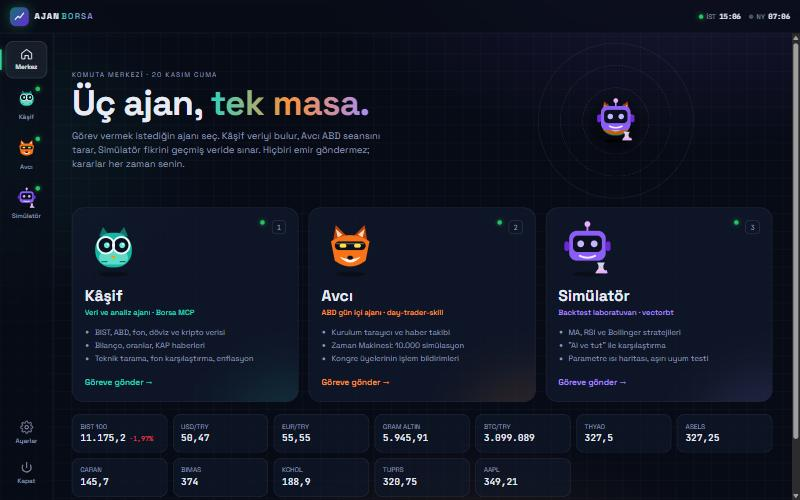
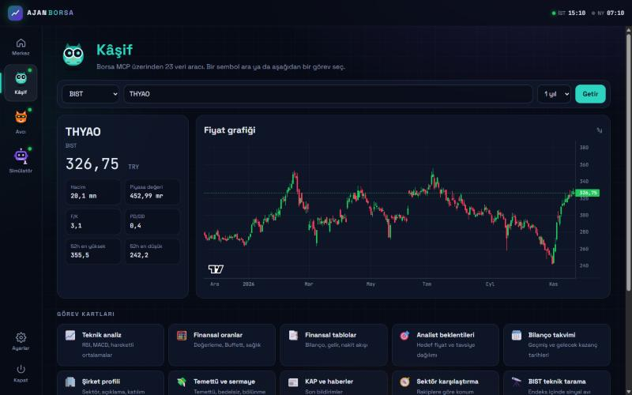
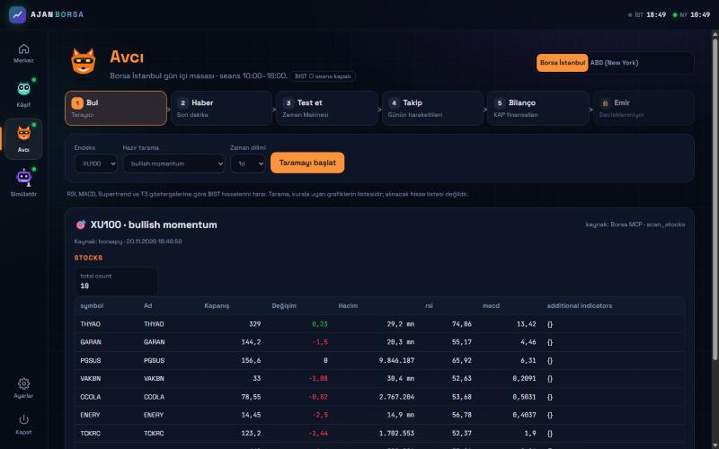
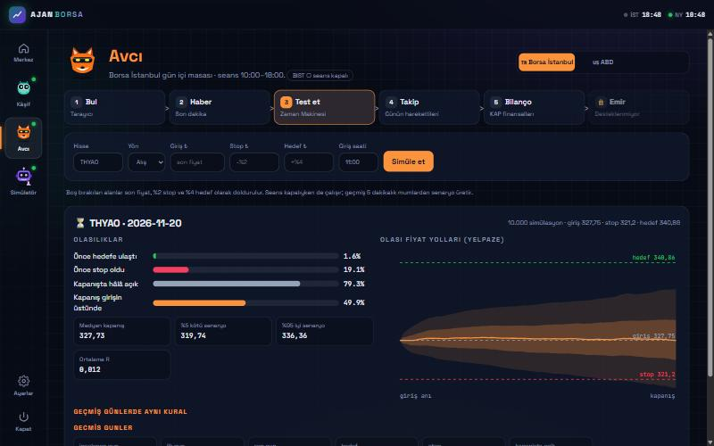
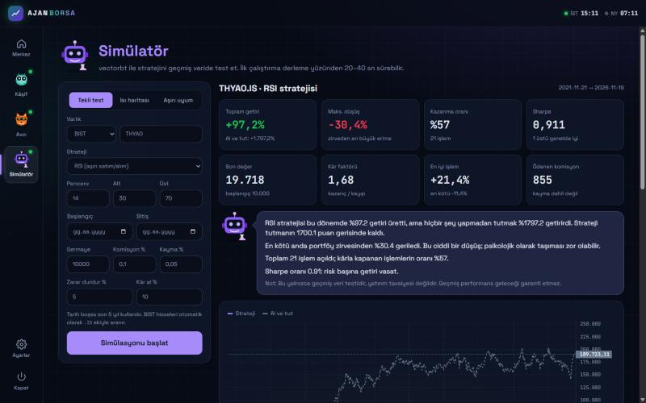
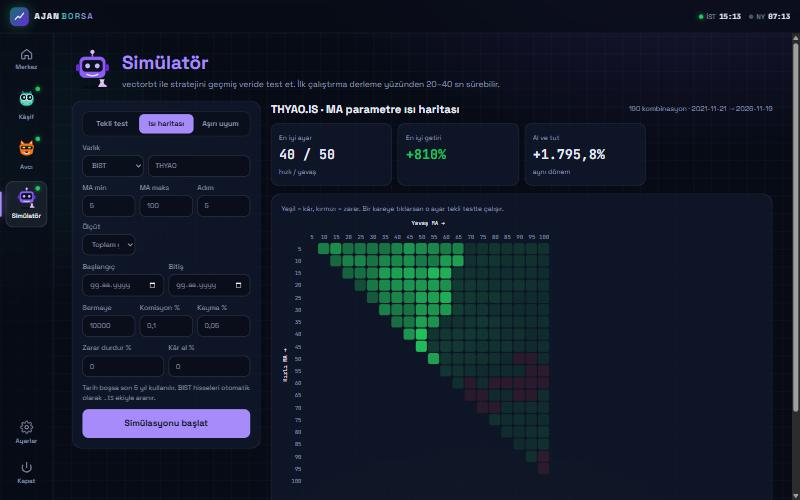
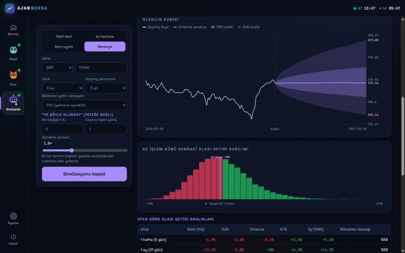
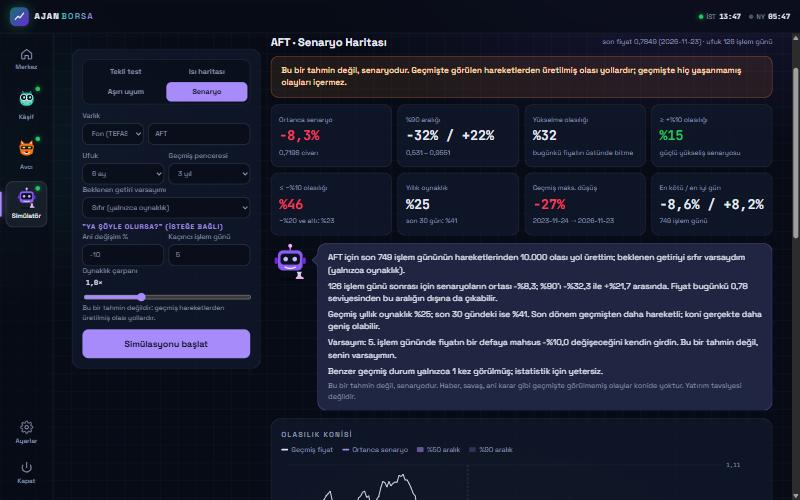
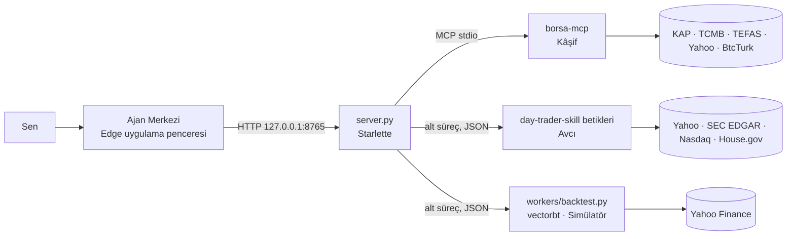

# Ajan Borsa 🦉🦊🤖

**Üç açık kaynak borsa ajanını tek pencerede toplayan, Türkçe, yerel bir komuta merkezi.**

Ajan Borsa yeni bir analiz motoru yazmaz. Başkalarının yazdığı üç güçlü projeyi bir araya getirir,
tek tıkla kurar ve hepsine tek bir görsel panelden ulaşmanı sağlar.

| Ajan | Arkasındaki proje | Geliştiren | Ne yapar |
|---|---|---|---|
| 🦉 **Kâşif** | [borsa-mcp](https://github.com/saidsurucu/borsa-mcp) | [@saidsurucu](https://github.com/saidsurucu) (Said Sürücü) | BIST, ABD, fon, döviz, kripto ve makro verisi; bilanço, oranlar, KAP haberleri, teknik tarama |
| 🦊 **Avcı** | [day-trader-skill](https://github.com/Jakeschincariol/day-trader-skill) + Borsa MCP | [@Jakeschincariol](https://github.com/Jakeschincariol) (Jake Schincariol) | **BIST modu:** teknik tarama, KAP haberleri, finansallar, BIST Zaman Makinesi. **ABD modu:** kurulum tarayıcı, haber, 10.000 simülasyonluk Zaman Makinesi, Kongre bildirimleri |
| 🤖 **Simülatör** | [vectorbt](https://github.com/polakowo/vectorbt) | [@polakowo](https://github.com/polakowo) (Oleg Polakow) | MA / RSI / Bollinger backtest, "al ve tut" karşılaştırması, ısı haritası, aşırı uyum testi. **Senaryo Haritası:** BIST/ABD hisse, endeks, kripto ve TEFAS fonları için olasılık konisi |

> Asıl emek bu projelerin sahiplerine aittir. Ayrıntılar, lisanslar ve diğer kütüphaneler: **[TESEKKURLER.md](TESEKKURLER.md)**

> ⚠️ **Yatırım tavsiyesi değildir.** Panel hiçbir koşulda alım-satım emri göndermez. Veriler ücretsiz kaynaklardan gelir, gecikmeli veya hatalı olabilir. Geçmiş performans geleceği garanti etmez.

## Ekran görüntüleri

| Ana menü | Kâşif |
|---|---|
|  |  |
| **Avcı · BIST taraması** | **Avcı · BIST Zaman Makinesi** |
|  |  |
| **Simülatör** | **Simülatör · Isı haritası** |
|  |  |
| **Senaryo Haritası · olasılık konisi** | **Senaryo Haritası · fon + "ya şöyle olursa"** |
|  |  |

## Kurulum (Windows)

Gerekenler: [Git](https://git-scm.com/download/win) ve [uv](https://docs.astral.sh/uv/getting-started/installation/). Python'u uv kendisi indirir.

```powershell
git clone https://github.com/sametbesni/ajan-borsa.git
cd ajan-borsa
powershell -ExecutionPolicy Bypass -File .\kur.ps1 -Kisayol
```

`kur.ps1` şunları yapar:
1. borsa-mcp ve day-trader-skill'i **kendi resmî depolarından** test edilmiş sürümde indirir (`-Guncelle` ile en son sürüm).
2. Her birinin bağımlılıklarını ayrı sanal ortamlara kurar; vectorbt'yi PyPI'dan kurar.
3. day-trader-skill'leri `.claude/skills/` içine kopyalar (Claude Code'da `/trader-scanner` vb. için).
4. `-Kisayol` ile masaüstüne kısayol, `-ClaudeKayit` ile borsa-mcp'yi Claude Code ve Claude Desktop'a MCP sunucusu olarak ekler.

## Kullanım

- **Panel:** `Ajan-Merkezi-Ac.cmd` (ya da masaüstü kısayolu). Edge uygulama penceresi olarak açılır; adres `http://127.0.0.1:8765`, yalnızca bu bilgisayardan erişilir.
- **Geçiş:** sol menü ya da klavyede `0` Merkez, `1` Kâşif, `2` Avcı, `3` Simülatör.
- **Kapatma:** sol alttaki **Kapat** düğmesi (arka plandaki sunucuyu da durdurur).
- **Claude ile:** `-ClaudeKayit` sonrası Claude'a doğrudan "THYAO'nun finansal oranlarını getir" gibi sorular sorabilirsin. Bu klasörde Claude Code açarsan Avcı'nın 11 komutu (`/trader-...`) da kullanılabilir.

### Senaryo Haritası (Simülatör → Senaryo)
Fiyatın geleceğini **tahmin etmez**. Geçmiş günlük hareketleri karıştırarak (blok bootstrap) 10.000 olası yol üretir ve
"geçmiş davranışa göre aralık ne kadar geniş olabilir?" sorusunu gösterir:
- **Olasılık konisi:** 1 hafta – 1 yıl ufkunda %50 ve %90 aralıkları, yükselme ve ±%10 olasılıkları.
- **"Ya şöyle olursa?":** Sen bir varsayım girersin (ör. 5. günde %-10 ani değişim, yıllık getiri beklentisi, oynaklık çarpanı); koni yeniden çizilir. Varsayım senindir, tahmin değildir.
- **Benzer geçmiş durumlar:** Geçmişte benzer bir düşüş/yükselişten sonra ne olduğunu gösterir; örnek sayısı azsa uyarır.
- Haber, savaş, ani karar gibi geçmişte görülmemiş olaylar konide yoktur. Fonlar için TEFAS verisi 1'er yıllık parçalarla çekilir.

### Bilinmesi gerekenler
- Kâşif'in ilk isteği 15–25 sn sürebilir (Borsa MCP ısınıyor).
- Avcı'nın sağ üstünden **Borsa İstanbul / ABD** arasında geçiş yapılır. day-trader-skill yalnızca ABD seansı için yazıldığından BIST modu Borsa MCP araçlarını ve Ajan Borsa'nın kendi BIST Zaman Makinesi'ni kullanır. Emir adımı yalnızca ABD (Alpaca paper) içindir.
- ABD modunda seans TR saatiyle 17:30–00:00 (kış saati); kapalıyken Zaman Makinesi'ni "Örnek veriyle dene" ile deneyebilirsin.
- Avcı'nın Bilanço sekmesi, SEC'in istediği "Ad Soyad e-posta" User-Agent'ını Ayarlar'dan girmeni ister.
- Simülatör'ün ilk çalıştırması derleme yüzünden 20–40 sn sürer.

## İsteğe bağlı: Alpaca paper (sanal para) hesabı

Yalnızca Avcı'nın **emir** adımı (Claude Code'da `/trader-broker`) için gerekir; panel emir göndermez.
Anahtarlarını kimseyle ve hiçbir sohbette paylaşma. Hesabı açıp paper anahtarlarını aldıktan sonra:

```powershell
powershell -ExecutionPolicy Bypass -File .\araclar\alpaca-baglanti-kur.ps1
```

Betik anahtarları gizli giriş ile ister, **paper** sunucusunda doğrular (canlı anahtarlar burada çalışmaz) ve
[alpaca-mcp-server](https://github.com/alpacahq/alpaca-mcp-server)'ı Claude Desktop'a `ALPACA_PAPER_TRADE=true` ile ekler.
Bu depodaki `.claude/settings.json`, Claude Code'da emir araçlarını her seferinde onay isteyecek şekilde kilitler.

## Mimari



Her ajan kendi sanal ortamında çalışır; panel onların kodunu değiştirmez, yalnızca çağırır.

```
ajan-borsa/
├─ ajan-merkezi/           panel: server.py, web/ (HTML/CSS/JS), workers/ (backtest, bist_zaman, scenario)
├─ araclar/                yardımcı betikler (Alpaca bağlantısı)
├─ vectorbt-lab/           vectorbt örnek betiği ve bağımlılık listesi
├─ kur.ps1                 tek adımlı kurulum
├─ Ajan-Merkezi-Ac.cmd     paneli başlatır
├─ TESEKKURLER.md          emeği geçenler ve lisanslar
├─ borsa-mcp/              (kur.ps1 indirir, depoda yok)
└─ day-trader-skill/       (kur.ps1 indirir, depoda yok)
```

## Lisans

Bu depoda yazılan kod [MIT](LICENSE) lisanslıdır. Kullanılan projeler kendi lisanslarına tabidir:
borsa-mcp ve day-trader-skill **MIT**, vectorbt **Apache 2.0 + Commons Clause**. Commons Clause nedeniyle
bu sistem **ücret karşılığı satılmamalıdır**; kişisel ve eğitim amaçlıdır. Bkz. [TESEKKURLER.md](TESEKKURLER.md).
